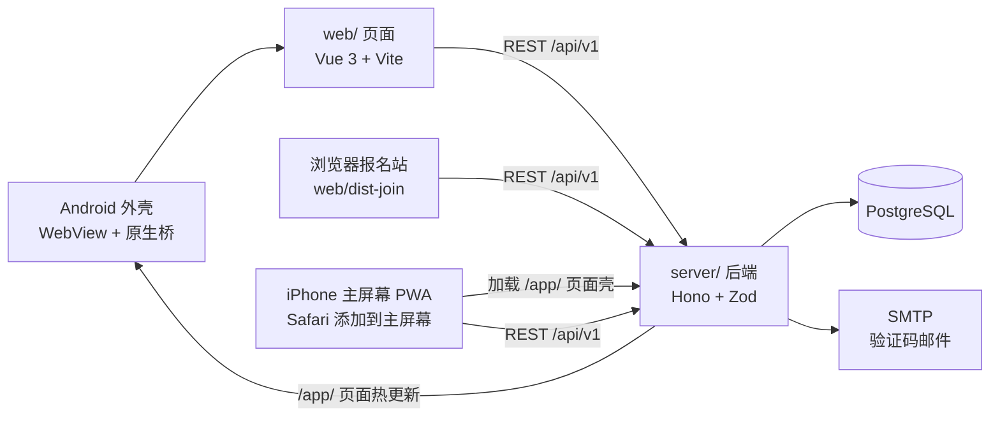

# CalMobile · 展会排期助手

[](https://github.com/Blathroat/calMobile/actions/workflows/ci.yml)

给参会者和展商用的展会报名与排期应用：浏览月历、查看展会、在线报名、展商审核、现场核销，附带一个不用装应用也能报名的浏览器报名站。

界面跑在 Android 的 WebView 里，也可以用 Safari 把完整应用以 PWA 方式加到 iPhone 主屏幕；业务数据在 Hono + PostgreSQL 后端；原生只负责设备能力（系统日历、摄像头、通知、文件、分享、通行密钥等），浏览器里同样的操作改用网页接口。

## 功能一览

- **月历与展会**：按天浏览展会与本人行程，展会详情、Markdown 简介、封面海报。
- **报名**：展商可配置收集项（文本 / 单选 / 多选）与审核方式；用户报名、修改、撤销，通过的报名出示二维码现场核销。
- **展商后台**：发布 / 编辑展会、配置报名设置与收集项、审核报名、核销报名码、分享报名二维码。
- **私人会议**：展商开放预约，访客提交申请，展商通过或拒绝。
- **浏览器报名站**：分享链接打开展会详情，未登录即可填表报名，提交后拿到查询链接；登录 / 注册可把报名关联到账号。
- **iPhone / PWA**：用 Safari 打开 `/app/` 并添加到主屏幕就是完整应用，月历、报名、展商后台、核销与设置都能用；设备能力改走浏览器接口。页面壳可离线打开，数据仍需联网，没有 APK 更新与推送。
- **账号与安全**：邀请码、限时展商、两步验证（通行密钥 / TOTP / 邮箱验证码）、备用码、可信设备、远程下线会话。
- **管理与设置**：用户 / 展会 / 会议管理，服务器设置、配色与品牌、上传与存储上限、邀请码、软件包下载源、用户协议、操作日志。
- **多语言**：内置中文，支持安装语言包（本机存储，不随页面发布）。

## 架构



- **应用页面**打进 APK 一份；正式包打开接口源的 `/app/index.html`，WebView 拦截到本机快照，支持整页热更新。同一份 `/app/` 产物也供 iPhone 主屏幕应用加载。
- **浏览器报名站**是第二份构建（`web/dist-join`），由后端直接托管，不进 APK。
- **iPhone / PWA**：Safari 打开 `/app/` 并添加到主屏幕就是完整应用，不需要 APK；名称与描述取自中文文案，Web App Manifest、Service Worker 与主屏幕图标在构建时生成（可用 `PWA_*` 构建变量覆盖名称与描述）。Service Worker 只缓存页面壳，接口与数据仍走网络。
- 业务数据只走后端，前端不直接访问数据库；原生桥只做设备能力，浏览器里同样的操作改用网页接口。

## 技术栈

| 层 | 技术 |
| --- | --- |
| Android 外壳 | Java + WebView，`minSdk 24` / `targetSdk 36`，Gradle |
| iPhone / PWA | Safari「添加到主屏幕」，Web App Manifest + Service Worker（只缓存页面壳） |
| 前端 | Vue 3、Vite、vue-router、Pinia、TypeScript（`vue-tsc`） |
| 后端 | Node.js、Hono、Zod、`pg` 手写 SQL、JWT、bcrypt、`@simplewebauthn/server` |
| 数据库 | PostgreSQL |
| 开发辅助 | Docker Compose（PostgreSQL + Mailpit）、pnpm |

详细约定见 [`docs/engineering.md`](docs/engineering.md) 与 [`server/README.md`](server/README.md)。

## 目录

```text
app/            Android 外壳（WebView、原生动作桥、系统日历 / 摄像头 / 相册 / 分享等）
web/src/        应用页面与报名站共用的 Vue 页面、组件、服务
web/join.html   报名站入口（历史路由，构建到 web/dist-join）
web/public/     PWA 安装图标（manifest 与 Service Worker 由构建生成）
server/         Hono 后端：认证、展会、报名、审核、核销、设置、通知、日志
deploy/         服务器更新器与 systemd 单元样例
scripts/        构建目标、发布范围、运行时包等脚本
docs/           产品行为、工程边界、上线运维文档
lang-packs/     本机语言包工作区（不入库）
```

## 快速开始

### 环境要求

- Node.js `^24.15.0 || >=26.0.0`（前后端一致，见各自 `package.json` 的 `engines`）
- pnpm 10+
- Docker（开发用的 PostgreSQL 与 Mailpit）
- Android 开发时需要 JDK 与 Android SDK；`local.properties` 指向本机 SDK

### 1. 启动依赖服务

```bash
docker compose up -d
```

会起两个容器：`calmobile-pg`（PostgreSQL 18，库名 `calmobile_dev`，端口 `127.0.0.1:5432`）和 `calmobile-mail`（Mailpit，收验证码邮件）。

### 2. 启动后端

```bash
cd server
pnpm install --frozen-lockfile
cp .env.example .env      # 按注释填密钥；本地开发默认值可直接用
pnpm db:migrate           # 建表 + 迁移
pnpm db:seed              # 仅开发库：示例账号与数据
pnpm dev                  # http://127.0.0.1:3000，同时托管报名站
```

示例账号（仅开发库）：`demo`（管理员）、`exhibitor`（展商）、`user`（普通用户），密码都是 `password`。

### 3. 开发页面

```bash
cd web
pnpm install --frozen-lockfile
pnpm dev        # 应用页面开发服务器
pnpm build:join # 报名站构建（server 的 pnpm dev 也会自动构建）
```

真机调试时 `pnpm dev` 会自动维护 `adb reverse tcp:3000 tcp:3000`；服务不是它起的时候自己执行这条命令。

### 4. 构建调试 APK

```bash
./gradlew :app:assembleDebug
# Windows: gradlew.bat :app:assembleDebug
```

调试包使用当前配置，不要求公网地址或签名。正式包要求 `APP_API_BASE` 是公网 https、包名不是 `com.example`、签名四项齐全。

## 构建与发布

- **CI**：`.github/workflows/ci.yml` 在 push / PR 时跑前后端与契约测试。
- **Release**：合入 `master` 且推送 CI 成功后，`.github/workflows/release.yml` 按改动路径发布：
  - GitHub Releases 上的 APK（标签 `v0.1.<运行编号>`）
  - 公开 npm 上的运行时包 `calmobile-server@0.1.<运行编号>`（含后端产物与两份页面构建）
- **服务器更新**：服务器上的 `calmobile-update.timer` 每 5 分钟从 npm 检查新版本，安装依赖、跑迁移、原子切换并重启服务；失败自动回滚。
- **反向代理 / TLS / 通行密钥**：域名、证书、`assetlinks.json`、环境变量等上线步骤见 [`docs/operations.md`](docs/operations.md)。

会触发发布的新改动不要直接推到 `master`，按仓库协作约定走 PR、用合并提交合入。

## 测试与校验

| 改动范围 | 命令 |
| --- | --- |
| 前端页面 / 组件 / 样式 / 文案 | `pnpm --dir web typecheck`、`pnpm --dir web lint`、`pnpm --dir web fmt:check`、`pnpm --dir web test`、`pnpm --dir web build` |
| 报名站页面 | 上面的命令 + `pnpm --dir web build:join` |
| 后端规则 / 响应 | `pnpm --dir server lint`、`pnpm --dir server fmt:check`、`pnpm --dir server test`、`pnpm --dir server test:contract`（需要 PostgreSQL） |
| Android / 桥接 | `gradlew.bat :app:testDebugUnitTest`；出包再跑 `:app:assembleDebug` |

契约测试会自己起服务并连真实数据库，每个测试文件克隆一份独立数据库，可并行执行。

## 文档

| 文档 | 内容 |
| --- | --- |
| [`docs/product.md`](docs/product.md) | 用户可见行为、角色、限制与未决项 |
| [`docs/engineering.md`](docs/engineering.md) | 客户端 / 前后端边界、外壳、数据加载、界面与文案规则 |
| [`docs/operations.md`](docs/operations.md) | 按改动验证、构建、发布、服务器更新与环境变量 |
| [`server/README.md`](server/README.md) | 服务骨架、响应约定、业务规则、数据模型与依赖取舍 |
| [`AGENTS.md`](AGENTS.md) | 改代码前必读的仓库规则 |

## 说明

- 应用必须连接后端，没有离线数据层。iPhone 主屏幕应用的页面壳可以离线打开，月历、展会与报名数据仍需联网。
- iPhone 不提供 APK：用 Safari 打开 `/app/` 并添加到主屏幕即可，页面包在下次打开时更新；没有检查更新与自动更新。
- 上传的头像、封面与简介媒体保存在服务器；视频只校验大小与后缀，不转码。
- 通知只有数据库记录与系统权限申请，没有推送通道。
- 语言包安装在用户本机，不随应用页面发布更新；主屏幕名称与图标来自构建时的清单，安装后不随语言包变化，改名称或图标要重新添加。
- 本地 `lang-packs/`、`.env`、签名文件与构建产物不进仓库；发布包由 CI 按路径自动生成。
