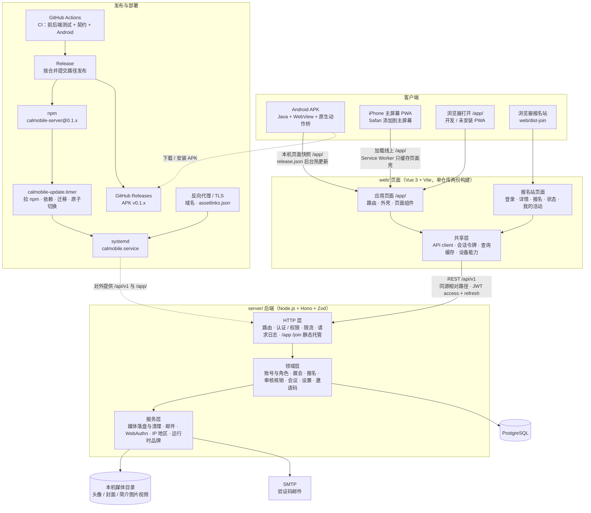
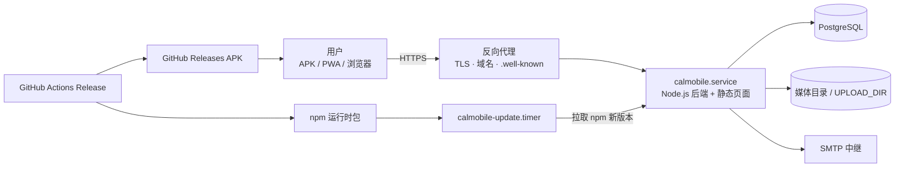

# CalMobile · 展会排期助手

[](https://github.com/Blathroat/calMobile/actions/workflows/ci.yml)

给参会者和展商用的展会报名与排期应用：浏览月历、查看展会、在线报名、展商审核、现场核销，另有一份不用安装应用也能报名的浏览器报名站。

界面跑在 Android WebView 里，也可以用 Safari 把完整应用以 PWA 方式添加到 iPhone 主屏幕；业务数据由 Hono + PostgreSQL 后端提供；原生只负责设备能力，浏览器里同样的操作改走网页接口。

## 功能

- **月历与展会**：按天浏览展会与本人行程；展会详情、Markdown 简介、封面海报、加入系统日历。
- **报名**：展商配置收集项（文本 / 单选 / 多选）与审核方式；用户报名、修改、撤销，通过的报名出示二维码现场核销。
- **展商后台**：发布 / 编辑展会、配置报名设置与收集项、审核报名、核销报名码、分享报名二维码。
- **私人会议**：展商开放预约，访客提交申请，展商通过或拒绝。
- **浏览器报名站**：分享链接直接打开展会详情，未登录可填表报名并拿到查询链接；登录 / 注册可把报名关联到账号。
- **iPhone / PWA**：Safari 打开 `/app/` 并添加到主屏幕就是完整应用；页面壳可离线打开，数据仍需联网。
- **账号与安全**：邀请码、限时展商、两步验证（通行密钥 / TOTP / 邮箱验证码）、备用码、可信设备、远程下线会话。
- **管理与设置**：用户 / 展会 / 会议管理，服务器设置、配色与品牌、上传与存储上限、邀请码、下载源、用户协议、操作日志。
- **多语言**：内置中文，支持安装语言包（存在本机，不随页面发布）。

## 架构



### 页面与数据流

1. **三端共用一份页面代码**：`web/dist` 是应用页面，同时服务 Android WebView 与 iPhone 主屏幕应用（都在 `/app/`）；`web/dist-join` 是浏览器报名站，由后端直接托管。页面不写死域名，接口和媒体一律用 `/api/v1`、`/media/...` 相对路径。
2. **页面交付**：正式 APK 先加载接口源的 `/app/index.html`，WebView 拦截后读本机快照；首屏之后后台拉 `/app/release.json`，新文件留到下次冷启动生效。PWA 直接加载线上 `/app/`，Service Worker 只预缓存页面壳，接口与媒体不缓存。
3. **接口与数据**：所有业务读写都经 `web/src/api/client.ts` 走 REST；访问令牌过期先刷新一次再重放，刷新被拒才清会话。业务数据只存在 PostgreSQL，前端不直接访问数据库，原生不持有业务数据。
4. **媒体**：头像、封面与简介里的图片 / 视频由设备选择并压缩，再上传到服务器媒体目录；`/media/...` 对外提供，未被引用或打不开的文件会被清理。
5. **设备能力**：系统日历、通知权限、摄像头、选图 / 落盘、分享、CSV、通行密钥等由原生桥提供；没有原生桥时自动落到浏览器实现（文件选择、下载、Web Share、通知权限、摄像头、WebAuthn）。
6. **通行密钥**：服务端生成并校验 WebAuthn 挑战；App 内交给系统凭据提供方（Android Credential Manager），浏览器里用 `navigator.credentials`，两条路的凭据 JSON 同形。
7. **发布与更新**：功能分支合并到 `master` 后，CI 成功触发 Release：GitHub Releases 发布 APK，npm 发布运行时包；服务器上的更新器定时从 npm 拉新版本，安装依赖、跑迁移、原子切换并重启，失败回滚。

### 部署拓扑



## 技术栈

| 层 | 技术 |
| --- | --- |
| Android 外壳 | Java + WebView，`minSdk 24` / `targetSdk 36`，Gradle |
| iPhone / PWA | Safari「添加到主屏幕」，Web App Manifest + Service Worker（只缓存页面壳） |
| 前端 | Vue 3、Vite、vue-router、Pinia、TypeScript（`vue-tsc`） |
| 后端 | Node.js、Hono、Zod、`pg` 手写 SQL、JWT、bcrypt、`@simplewebauthn/server` |
| 数据库 | PostgreSQL |
| 开发辅助 | Docker Compose（PostgreSQL + Mailpit）、pnpm |

## 目录

```text
app/            Android 外壳（WebView、原生动作桥、系统日历 / 摄像头 / 相册 / 分享等）
web/src/        应用页面与报名站共用的 Vue 页面、组件、服务
web/join.html   报名站入口（构建到 web/dist-join）
web/public/     PWA 安装图标（Manifest 与 Service Worker 构建生成）
server/         Hono 后端：认证、展会、报名、审核、核销、设置、通知、日志
deploy/         服务器更新器、实例 env 样例与 systemd 单元模板
scripts/        构建目标、发布范围、运行时包等脚本
docs/           产品行为、工程边界、上线运维、后端设计
docs/agents/    agent 工作规则与实现细节
lang-packs/     本机语言包工作区（不入库）
```

## 快速开始

### 环境要求

- Node.js `^24.15.0 || >=26.0.0`（见前后端 `package.json` 的 `engines`）
- pnpm 10+
- Docker（开发用的 PostgreSQL 与 Mailpit）
- Android 开发另需 JDK 与 Android SDK（`local.properties` 指向本机 SDK）

### 1. 启动依赖服务

```bash
docker compose up -d
```

起 `calmobile-pg`（PostgreSQL 18，库名 `calmobile_dev`，端口 `127.0.0.1:5432`）与 `calmobile-mail`（Mailpit）。

### 2. 启动后端

```bash
cd server
pnpm install --frozen-lockfile
cp .env.example .env      # 按注释填密钥；本地开发默认值可直接用
pnpm db:migrate
pnpm db:seed              # 仅开发库：示例账号与数据
pnpm dev                  # http://127.0.0.1:3000，同时托管报名站
```

示例账号（仅开发库）：`demo`（管理员）、`exhibitor`（展商）、`user`（普通用户），密码都是 `password`。

### 3. 开发页面

```bash
cd web
pnpm install --frozen-lockfile
pnpm dev        # 应用页面开发服务器
pnpm build:join # 报名站构建（server 的 pnpm dev 也会自动构建）
```

真机调试时 `pnpm dev` 会自动维护 `adb reverse tcp:3000 tcp:3000`。

### 4. 构建调试 APK

```bash
./gradlew :app:assembleDebug
# Windows: gradlew.bat :app:assembleDebug
```

调试包不要求公网地址或签名；正式包要求 `APP_API_BASE` 是公网 https、包名不是 `com.example`、签名四项齐全。

## 测试与校验

| 改动范围 | 命令 |
| --- | --- |
| 前端页面 / 组件 / 样式 / 文案 | `pnpm --dir web typecheck`、`lint`、`fmt:check`、`test`、`build` |
| 报名站页面 | 上面的命令 + `pnpm --dir web build:join` |
| 后端规则 / 响应 | `pnpm --dir server lint`、`fmt:check`、`test`、`test:contract`（需要 PostgreSQL） |
| Android / 桥接 | `gradlew.bat :app:testDebugUnitTest`；出包再跑 `:app:assembleDebug` |

契约测试会自己起服务并连真实数据库，每个测试文件克隆一份独立数据库，可并行执行。

## 文档

| 文档 | 内容 |
| --- | --- |
| [`docs/product.md`](docs/product.md) | 用户可见行为、角色与限制 |
| [`docs/engineering.md`](docs/engineering.md) | 客户端 / 前后端边界与工程结构 |
| [`docs/operations.md`](docs/operations.md) | 按改动验证、构建、发布、服务器更新与环境变量 |
| [`docs/server.md`](docs/server.md) | 后端骨架、接口约定、业务规则与数据模型 |

改代码的协作规则见 [`AGENTS.md`](AGENTS.md)；文件级实现细节、领域词表与工单流程在 [`docs/agents/`](docs/agents/)。

## 说明

- 应用必须连接后端，没有离线数据层；iPhone 主屏幕应用只把页面壳缓存在本机。
- 图标默认取 `web/public/icons/icon-1024.png`，构建期可用 `APP_ICON` / `APP_ICON_BACKGROUND` 覆盖，服务器运行时可再按实例生成。
- iPhone 不提供 APK：Safari 打开 `/app/` 添加到主屏幕即可，页面包在下次打开时更新，没有应用内更新与推送。
- 上传的头像、封面与简介媒体保存在服务器；视频只校验大小与后缀，不转码。
- 通知只有数据库记录、通知偏好与系统权限申请，没有推送通道。
- 语言包安装在用户本机，不随应用页面发布；主屏幕名称与图标来自安装时的清单。
- `lang-packs/`、`.env`、签名文件与构建产物不进仓库。
